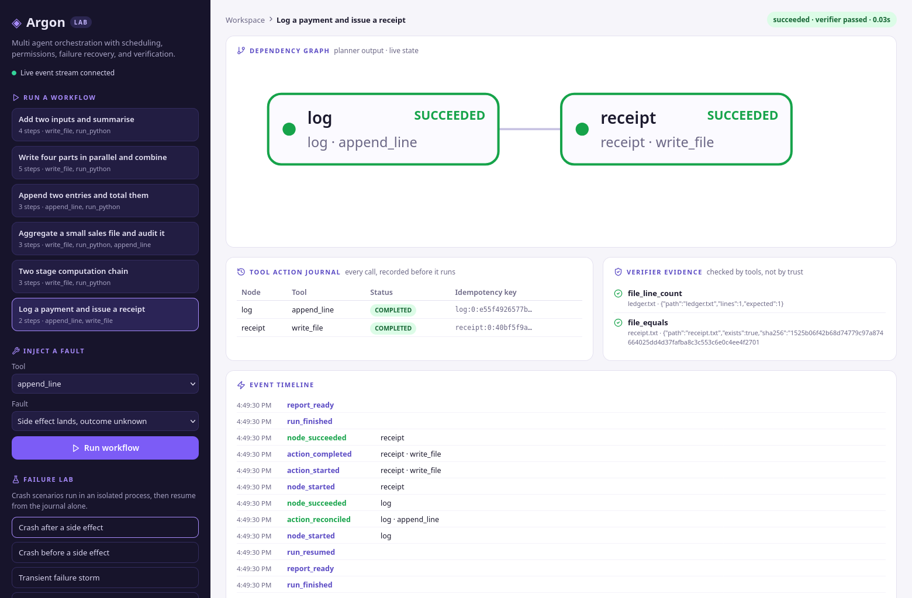

# Argon

### Agents, treated like a distributed system.

Argon is a multi-agent orchestration framework in Python. It splits a task across a planner agent, executor agents, and a verifier agent, and it worries about the things distributed systems worry about: scheduling, permissions, failure recovery, and verification. Splitting the work is easy. Knowing what actually happened when something dies halfway through is the interesting part, and it is what Argon is built around.

**Live dashboard:** run the server (below) and open http://localhost:8000 to watch the dependency graph, the tool action journal, and the verifier work in real time, and to inject failures yourself.



## Why it exists

A single agent doing everything in one loop is a process with no memory. If it crashes after sending a payment but before recording that it sent the payment, a restart has two bad options: do the step again and pay twice, or skip it and lose the work. Argon gives the runtime a durable journal so that question has an evidence based answer instead of a guess.

## Measured results

Everything below was produced by the benchmark and failure lab in this repo. Reproduce them with two commands (see Running the numbers). The offline runs use a deterministic stub model, so they measure the orchestration, not language model quality. A real model can be plugged in through an OpenAI compatible endpoint.

**Benchmark: 100 tasks, same tools and acceptance checks for both systems, identical seeded fault plans (49 clean, 28 transient failures, 14 uncertain outcomes, 9 process crashes).**

| | Completed | Median task time |
|---|---|---|
| Argon | **100 / 100** | 0.127s |
| Single agent baseline | 75 / 100 | 0.032s |

The baseline lost every crash task (its work lived in memory), most tasks where a tool failed twice in a row (it retries once), and the uncertain tasks where the side effect was an append it could not tell had already landed, so it appended twice and failed the check. Its worst template was report generation (12 of 20) and its best were the single append ledgers (15 of 20): the more steps and appends a task has, the more ways an in memory loop finds to lose or duplicate work. Argon completed 20 of 20 on all five templates. Argon is slower per task: every action and event is a journal transaction, and that durability is the cost. On tasks this small there is no model latency to hide it. The trade is explicit: a few centiseconds of journaling for runs that finish and can prove what they did.

**Failure lab: 50 injected failure scenarios, 50 recovered correctly.** Ten each of: crash after a side effect lands, crash before it, transient failure storms, uncertain write outcomes, and timeouts on pure tools. Every scenario checks hard postconditions on the real workspace and journal (exact file contents, exact line counts, actions executed once), not just a success flag.

## How it works

**Durable DAG scheduler** (`argon/core.py`). The planner turns a task into a DAG of tool calls. The scheduler runs independent nodes in parallel with asyncio, enforces dependencies, retries, and timeouts, and checkpoints every node transition to SQLite. A run can be resumed after the process dies; finished nodes are skipped, interrupted ones are reconciled.

**Tool action journal.** Every tool call is written to the journal before it runs, keyed by an idempotency key scoped to its node. Each action ends in exactly one state:

- `completed` — the side effect definitely happened. On resume the stored result is replayed, never re-executed.
- `failed` — it definitely did not happen. Safe to retry, and the scheduler does, up to the node's retry budget.
- `uncertain` — the call timed out or the process died mid flight, so nobody knows. Uncertain actions are **never retried blindly**. A reconciler checks the evidence (for a file write: does the file hold exactly the intended content?) and only then is the action marked completed, or cleared for safe re-execution. Pure tools (computation, reads) are always safe to re-execute and the reconciler knows it.

**Role scoped tool gateway** (`argon/tools.py`). Agents never call tools directly. Following the MCP pattern, each role gets a manifest of only the tools it may use (planner: read only; executor: read, write, compute, run code; verifier: read and check only) and the gateway enforces it on every call. Code execution runs sandboxed: Docker with no network when Docker is available, otherwise a subprocess with CPU and memory limits and a scrubbed environment. The mode used is reported in every result.

**Evidence based verifier** (`argon/agents.py`). After execution, the verifier checks each acceptance criterion with its own tool calls under the read only verifier role. A run counts as successful only when the scheduler finished *and* the verifier's evidence checks pass. Agents do not grade their own homework.

**Failure lab** (`argon/lab.py`). Deterministic fault injection (transient failures, outcomes that land but report unknown, slow calls, full process crashes) with resume and inspection: node states, the full action journal, and the event timeline for every scenario.

## Running it

```sh
pip install -r requirements.txt
python -m pytest            # 52 tests: scheduler, journal, gateway,
                            # agents, orchestrator, API
```

Dashboard (planner, graph, journal, verifier, failure lab, live):

```sh
cd dashboard && npm install && npm run build && cd ..
python -m argon.server      # http://localhost:8000
```

Running the numbers:

```sh
python -m argon.benchmark   # writes benchmarks/results.json
python -m argon.lab         # writes benchmarks/failure-lab-results.json
```

Using a real model instead of the stub:

```sh
export ARGON_MODEL_BASE_URL=http://localhost:11434/v1   # or any provider
export ARGON_MODEL=your-model
export ARGON_API_KEY=...
```

This path is tested end to end with Google's Gemini (gemini-3.8-flash) through its OpenAI compatible endpoint on the free tier: Gemini planned the payment workflow, the run verified, a crashed run resumed from its stored plan, and the payment ledger held exactly one entry afterwards. The model client retries transient API errors (429 and 5xx) with backoff, because free tier endpoints shed load often enough that a planner without retries looks broken.

## Layout

- `argon/core.py` — scheduler and journal (the heart)
- `argon/tools.py` — tool gateway, permissions, sandbox
- `argon/agents.py` — model clients, planner, verifier
- `argon/orchestrator.py` — runner and fault injector
- `argon/benchmark.py` — the 100 task fair benchmark and the baseline
- `argon/lab.py` — the 50 scenario failure lab
- `argon/server.py` — FastAPI API and live event stream
- `dashboard/` — React dashboard
- `docs/engineering.md` — design decisions, invariants, and limitations

## Honest limitations

- One scheduler worker is the authority for a run (the same simplifying choice Ledger makes); the journal format does not yet support multiple writers.
- Offline numbers measure orchestration with a stub model. Model quality comparisons need a real model plugged in, and will vary by model.
- `run_python` jobs run in a worker thread so the event loop stays responsive; long jobs are bounded by the sandbox timeout.
- Plans are stored in the journal with the run, and a resume executes the stored plan exactly as it was planned. Only runs recorded by older versions fall back to re-deriving a plan from the task.
